# PIPELINE.md — CAMT Bookshop

Rename this file to `PIPELINE.md` and fill every section. Links must be clickable URLs to
runs in **your** repository. Screenshots go in `docs/` and are linked from here.

Student ID: 662115010 Name: Chawaphat Akaraphat Repository: https://github.com/Chawaphat/camt-bookshop

Production URL: **\*\*\*\***\*\*\*\***\*\*\*\***\_\_\_\_**\*\*\*\***\*\*\*\***\*\*\*\***

## 1. Pipeline at a glance

Draw your pipeline as a Mermaid flowchart: the three workflows, their triggers, their jobs,
the `needs:` arrows between jobs, and where Vercel receives a deployment.

```mermaid
flowchart LR
  %% replace with your pipeline
```

## 2. Evidence

| AC        | What                                                                                | Link / screenshot                                                                                                                                                                                                                                                    |
| --------- | ----------------------------------------------------------------------------------- | -------------------------------------------------------------------------------------------------------------------------------------------------------------------------------------------------------------------------------------------------------------------- |
| AC-03.2   | screenshot of the Vercel dashboard's deployment list — every entry made by Actions  | 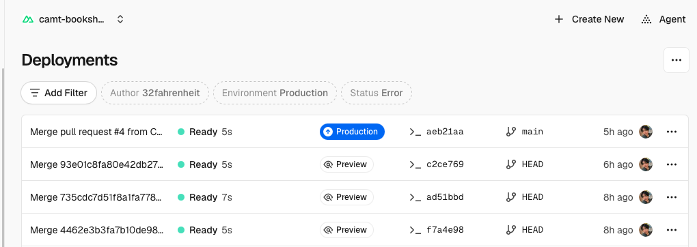 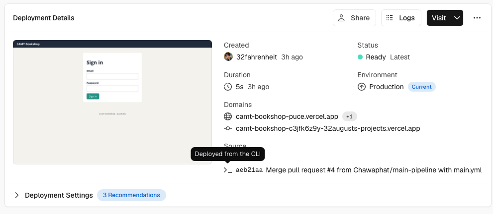                                                                                                                                                             |
| AC-03.4   | screenshot of Deployment Protection: Vercel Authentication on, bypass created       |                                                                                                                  |
| AC-04.3–4 | a green `PR gate` run: smoke → deploy-preview → test-preview, with the preview URL  | 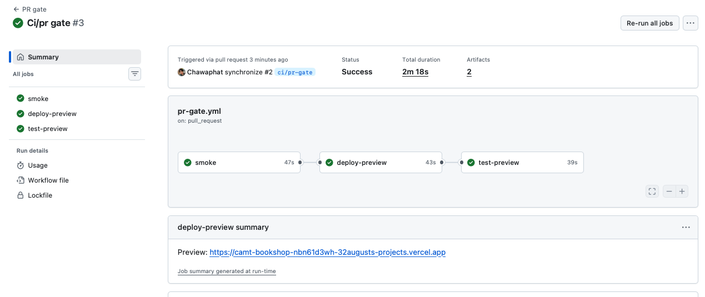                                                                                                                                                                                                           |
| AC-04.6   | the same run's duration, warm cache                                                 |                                                                                                                                                                                    |
| AC-05.1–3 | screenshot of the branch protection / ruleset settings                              | 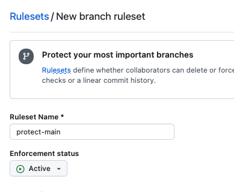 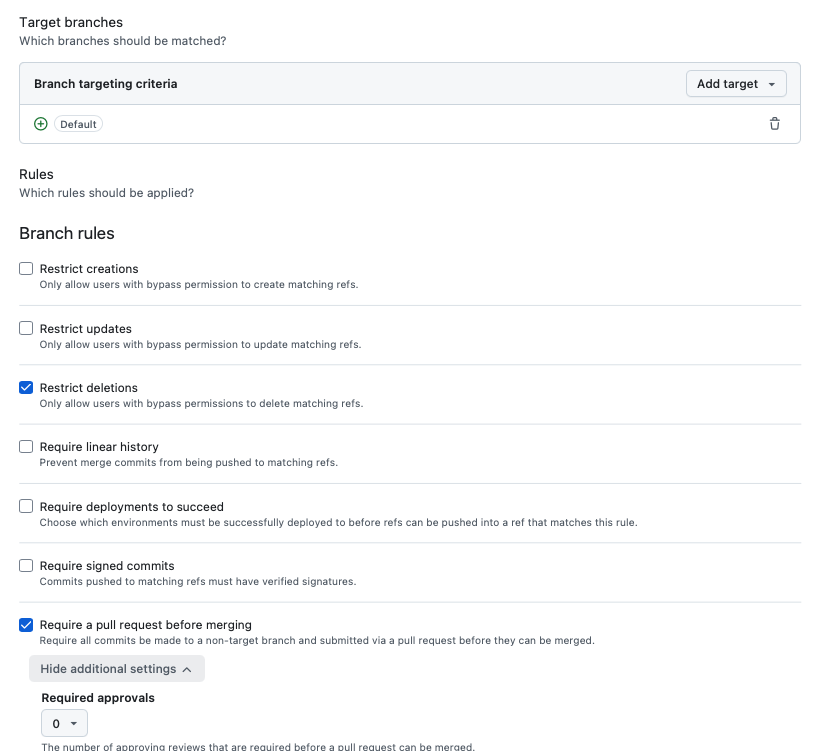 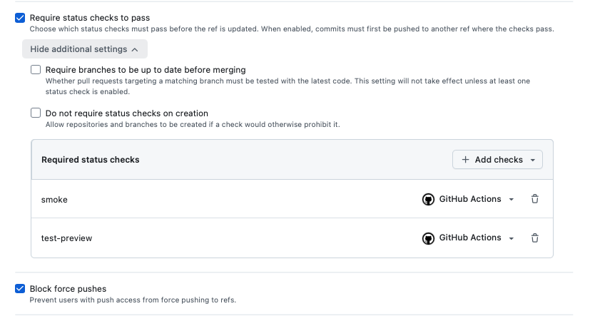 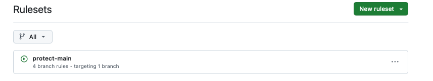                                                    |
| AC-05.4   | the pull request whose merge was blocked by a red required check                    | 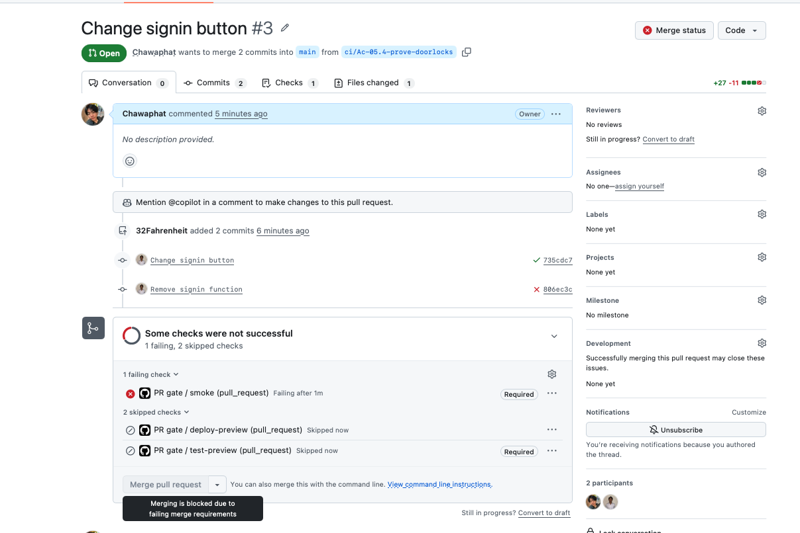                                                                                                                                                                                                                             |
| AC-06.3–4 | a green `Main pipeline` run: test → deploy-production → verify                      |                                                                                                                                                                                                               |
| AC-06.7   | the `Main pipeline` run with the test job red and the deploy skipped                | 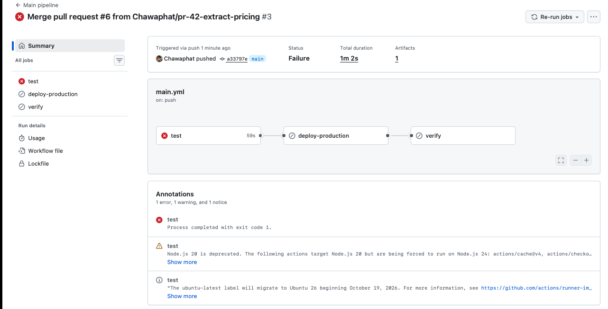                                                                                                                                                                                                                        |
| AC-07.2   | three `Nightly` runs started by hand — one per target — each with its merged report | 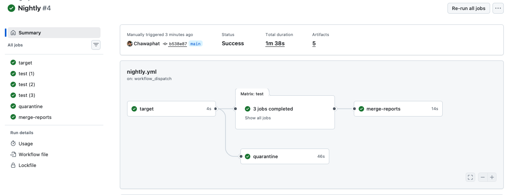 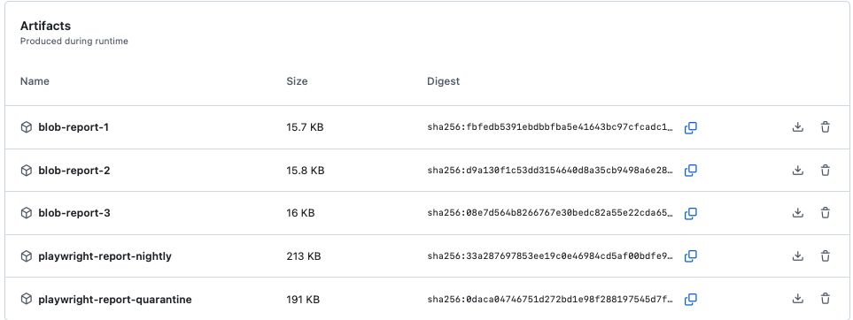 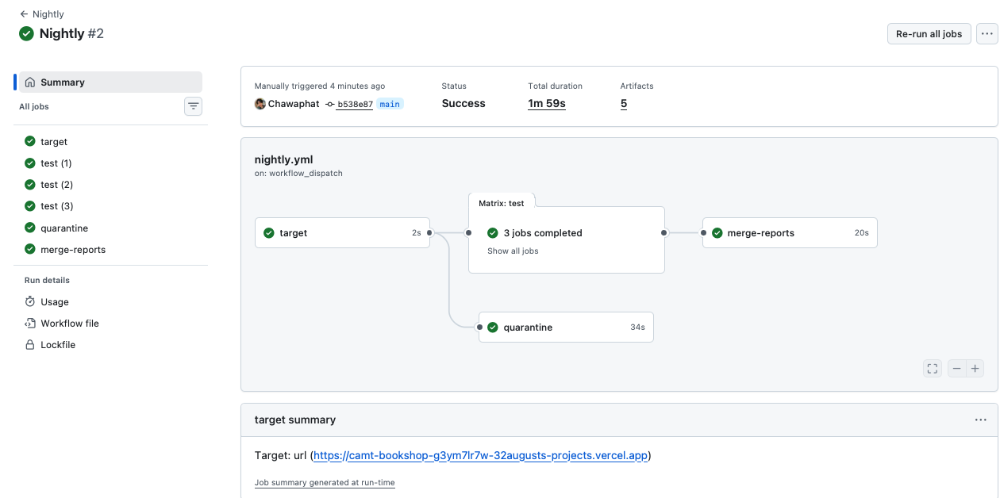 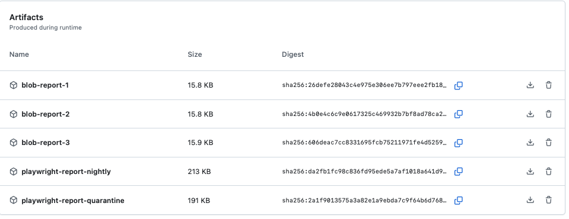 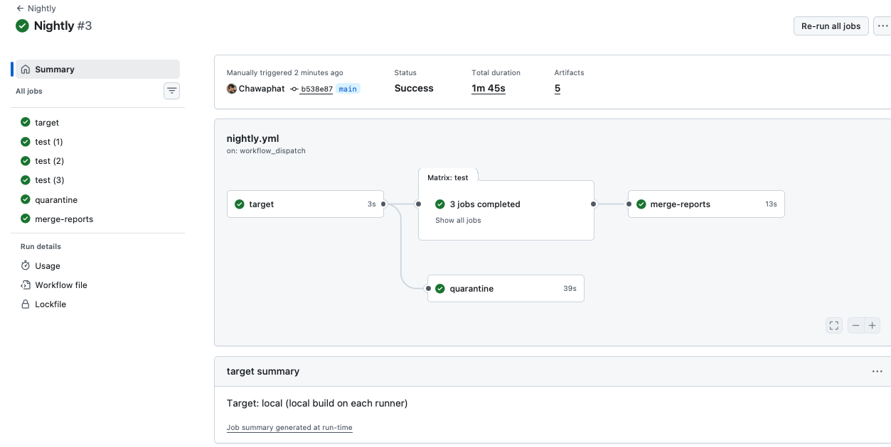 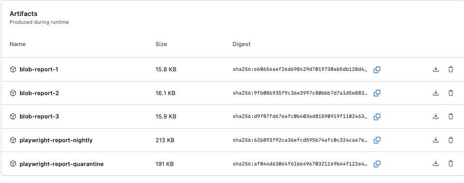 |
| AC-08.2   | the quarantine issue                                                                | 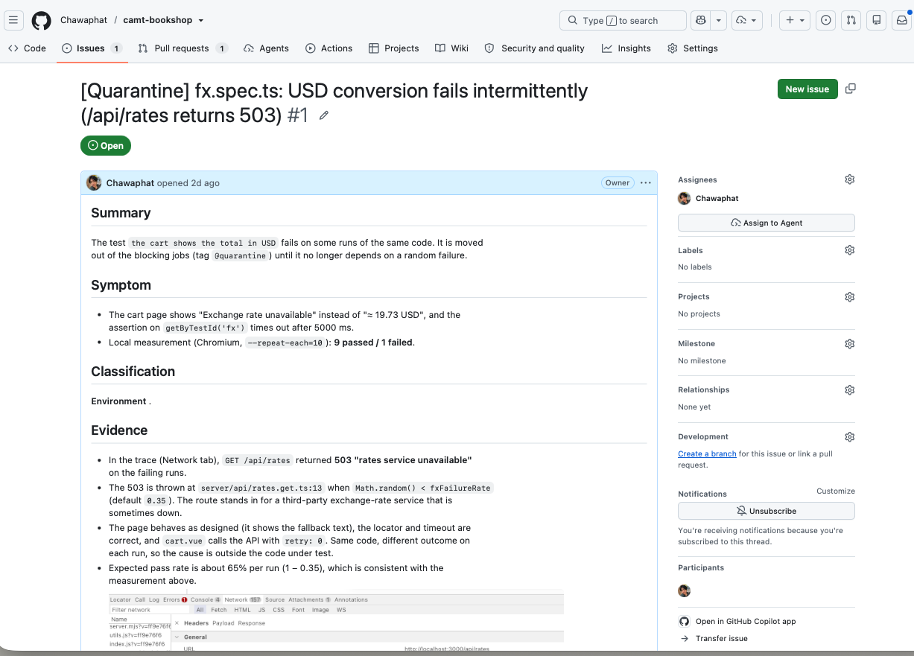                                                                                                                                                                                                                       |

## 3. Timings

| Run                                                   | Cold cache | Warm cache | Budget | Within? |
| ----------------------------------------------------- | ---------- | ---------- | ------ | ------- |
| PR gate (all three jobs)                              | 2m 18s     | 2m 4s      | 8 min  | yes     |
| Main pipeline (all three jobs)                        | 2m 17s     | 2m 8s      | 10 min | yes     |
| Nightly, target = production (start to merged report) | 1m 46s     | 1m 38s     | 20 min | yes     |
| Nightly, target = local (start to merged report)      | 1m 50s     | 1m 45s     | 20 min | yes     |

> Which step did the browser cache save the most time on, and how much? : The Playwright browser installation step. On the cold run Install Chromium (cache miss) took 52 s; on the warm run Install system dependencies only (cache hit) took 29 s, a saving of 23 s (about 44%).

> Nightly against production vs. against a local build — which was faster, and why? : Production was faster because it did not need to build the app on each shard. In local mode, every shard had to build the app before running the tests, which increased the total execution time.

## 4. Triage record — the quarantined test

|                                                   |                                                                                                                                                                                                        |
| ------------------------------------------------- | ------------------------------------------------------------------------------------------------------------------------------------------------------------------------------------------------------ |
| Symptom                                           | fx.spec.ts sometimes fails because /api/rates returns 503.                                                                                                                                             |
| Local measurement (`--repeat-each=10`)            | 9 passed / 1 failed                                                                                                                                                                                    |
| Classification (regression / flaky / environment) | environment                                                                                                                                                                                            |
| Evidence that decided it                          | rates.get.ts randomly returns 503 with a 35% failure rate to simulate an external service failure.                                                                                                     |
| Containment applied                               | - Tagged `@quarantine`, with a link to this issue and an expiry date, in `tests/fx.spec.ts`, - Blocking jobs do not run `@quarantine` tests. `retries` stays at 2 (not raised to make this test pass). |
| Cure (planned or done)                            | Replace the test with two tests that control `/api/rates` using `page.route`:one for a successful answer and one for an outage.                                                                        |
| Expiry date                                       | 2026-10-30                                                                                                                                                                                             |

## 5. The teammate's pull request (PR-42)

1. What the PR gate reported (all three jobs), and why: All 3 jobs (smoke, deploy-preview, test-preview) passed, so GitHub allowed the merge. The gate only runs the @smoke set , and none of those tests puts a cart exactly at the discount threshold, so the regression in Somchai's refactor was invisible to it.
2. What the main pipeline reported, and which test(s) caught it: The test job failed at the "Run full suite" step, in tests in cart.spec.ts and checkout.spec.ts . The cause is a boundary change in the extracted priceCart(): the discount condition went from subtotal >= DISCOUNT_THRESHOLD to subtotal > DISCOUNT_THRESHOLD, so a cart exactly at the threshold lost its discount. deploy-production and verify were skipped .
3. What the Vercel dashboard and the production URL showed while `main` was red: The dashboard listed no new production deployment; the latest production deployment was still the one from the last green run. The production URL kept serving that previous, working version.
4. How you restored `main`: I used the Revert button on the merged pull request. GitHub opened a new pull request containing a commit that undoes Somchai's change, I waited for the PR gate to pass, and merged it. No history was rewritten, and I did not edit any test to make it pass.
5. Your decision on Think first #10, with the reason: I tag the discount-boundary test @smoke and keep the full suite on main and in the nightly run.

## 6. Think-first answers

Copy all ten answers here, with the correction you made after running the command where
your first answer was wrong.

1. **Think first #1**
   > Predicted passes: 6

> Actual: 9

> Classification: Environment

> Evidence: The test fails because `GET /api/rates` sometimes returns 503 due to `Math.random() < fxFailureRate`, which has a 35% failure rate by default. The UI and test locator are correct. So, the same code can pass or fail randomly. Out of 10 runs, around 6–7 runs are expected to pass.

> 
> 

2. **Think first #2**

> 1. .vercel/ → Vercel deployment files would be uploaded to GitHub.
> 2. blob-report/ → Playwright test report files would be uploaded to GitHub.
> 3. .env → Environment variables and possibly secret keys would be uploaded to GitHub.

3. **Think first #3**
   > Failure rate without `retry: 0`: About 12% (0.35 × 0.35 = 0.1225), because the app makes two requests and the test fails only if both return 503.

> Why worse: App retries hide the problem but do not fix it. They make failures harder to reproduce and leave less clear evidence in test reports. Playwright retries can mark tests as flaky and save traces for debugging. They can also be configured differently for CI and local testing, without changing the app's behavior.

4.**Think first #4**

> Answer: No, the password is not safe. Git keeps the commit history, so the old password can still be found using git log -p or GitHub's commit history. Since the repository is public, someone may have already copied it.

> What a real team should do:
> Rotate the password immediately and revoke the old one.
> Check the logs for suspicious activity.
> If necessary, remove the password from Git history using git filter-repo or BFG, then force-push the changes.

5.**Think first #5**

> P(fail) with 2 retries: 0.35³ = 0.042875 ≈ 4.3% with 5 retries: 0.35⁶ ≈ 0.0018 ≈ 0.18%
> (retries: N means N + 1 attempts, and the run fails only if every attempt fails.)

> Why still no: Retries only hide failures; they do not fix the 35% failure rate of the exchange-rate service. They can also hide real bugs in our code. Even a 0.18% failure rate can cause false alarms over many runs, making the team ignore failed builds. Extra retries also use more of the 8-minute budget. Instead, quarantine the unreliable test and fix it by controlling /api/rates with page.route.

6. **Think first #6**
   > Vercel: Its Git integration sees the push to main and builds and deploys that commit to production by itself, in parallel with GitHub Actions and without waiting for it. The deployment shows source "Git" and status Ready in the dashboard, while the GitHub check is red.

> Customers see: The buggy version, live. The red test job cannot stop or roll back a deployment that Vercel made on its own; the bug stays on the production URL until someone reverts or rolls back. This is the same failure as the laptop vercel --prod incident in the spec: a deployment that never passed through the gate. "git": { "deploymentEnabled": false } in vercel.json (AC-03.2) removes that path, so production can only change when the pipeline runs the CLI after the tests pass.

7.**Think first #7**

> Private window shows: Vercel's own login page ("Log in to Vercel"), not the app. The preview is protected by Vercel Authentication, so a visitor who is not logged in to Vercel cannot reach it directly.

> Tests without the bypass: Playwright is a visitor with no Vercel login, so every page.goto() would receive Vercel's authentication page instead of the app. The sign-in form and the "Books" heading never appear, so essentially every test fails by timeout. These failures are not product bugs, and the timeout messages do not mention authentication, so the red result would mislead.

> Fixes: (a) Turn Vercel Authentication off, so previews are public. (b) Keep it on and give the pipeline Protection Bypass for Automation: a secret sent in the x-vercel-protection-bypass header. Chosen: (b). A preview holds a pull request's unreviewed code, so it should not be open to anyone with the link. With (b) only the pipeline, which holds the secret as a repository secret, gets in, and previews stay private for everyone else (PL-03 / AC-03.4).

> Correction: My first prediction was that the private window would show the app's sign-in page. In fact I first opened it from the dashboard's Visit button in a browser that was logged in to Vercel. In a real private window Vercel asks me to log in first.

8.**Think first #8**

> Why: GitHub does not read the workflow YAML to guess job names. It builds the list of selectable required checks from check names that have actually been reported on this repository by earlier runs (the picker searches recent check runs). Until the workflow has run once, smoke and test-preview have never been reported, so there is nothing to select.

> A PR with a broken workflow file shows: The workflow never starts, so no check named smoke or test-preview is ever reported. With those checks required, the merge box stays on "Expected — Waiting for status to be reported" and the merge stays blocked. It is neither green nor red, just permanently pending. (The Actions tab may also show an "invalid workflow file" error.) The gate fails closed: a broken gate cannot let code through, but it also blocks every PR until the YAML is fixed.

9. **Thinkfirst9**
   > (a) Yes, the PR gate should pass. Both smoke and test-preview run only the @smoke set (one fast test per user journey), and none of them puts a cart exactly at the discount threshold.

> (b) No, the main pipeline should fail at the test job, because it runs the full suite (everything except @quarantine). deploy-production would be skipped, so the bug never reaches production.

> (c) The failing test is the discount boundary test a cart whose subtotal equals DISCOUNT_THRESHOLD; . In priceCart() the condition changed from >= to >, so a cart exactly at the threshold loses its discount. Somchai's local check did not catch it because he ran only npm run test:smoke (4 tests), and that set does not contain the boundary test.

10.**Thinkfirst10**

> Tag it @smoke: For: It is the cheapest fix: one extra test of a few seconds, so the PR gate stays well inside its 8-minute budget . It catches this exact bug in both smoke and test-preview, before the merge.
> Against: The smoke set is defined as one test per user journey; tagging a test for every bug that slipped through makes it grow until it is no longer fast. It also only protects against bugs we already know about: this boundary was found after the damage, and the next one will be a different test.

> Full suite on the preview:
> For: It catches any bug the full suite can catch before merge, without having to guess which test matters, so "gate green, main red" can no longer happen.
> Against: The full suite takes 41 s on the test job versus 38 s for smoke test, and against a deployed URL it is slower still because of network latency. That would push the PR gate towards or past its 8-minute budget and slow every PR to protect against rare bugs. It also repeats what the test job already does on main.

> Decision and reason: Tag the boundary test @smoke and keep the full suite on main and nightly. The main pipeline is the safety net (as this incident showed: production was never touched), while the PR gate should stay fast so people keep using it. If the measured full-suite time is only a few seconds on top of the current gate, running the full suite on the preview would also be defensible, so the decision follows the timing budget.

## 7. One thing I would change

If you had a second week on this pipeline, what one change would make it more trustworthy
or cheaper, and how would you measure that it worked?

> I would fix `fx.spec.ts` by mocking `/api/rates` with `page.route` for both success and failure cases. Then, remove the `@quarantine` tag, close the issue, and add a CI check for expired quarantines.

> I would measure success by checking that currency tests pass every night for two weeks, no quarantine is expired, and removing the nightly job saves runner time.
